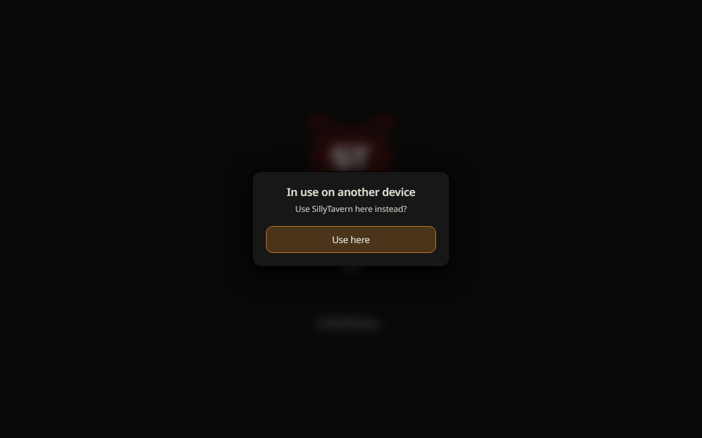
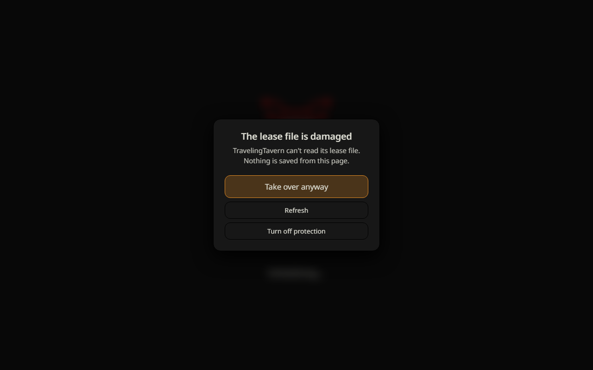
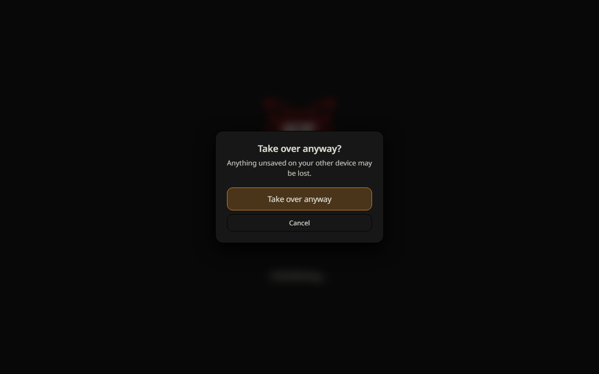

# TravelingTavern-Extension

A SillyTavern extension that lets only one SillyTavern page save at a time, so a tab you left open on another device can't erase newer work.

## Why

SillyTavern loads your chats, settings and lorebooks once, and later saves whole files from that copy. If SillyTavern is open on your desktop and your phone, and you chat on the phone, the desktop tab still has the old copy. The next time it saves, it writes that old copy back and your newer messages are gone.

With this extension, one page is in use at a time. Every other page waits behind a notice until you choose to use SillyTavern there. That page then reloads, so it always starts from your latest data.

## Install

1. In SillyTavern, open **Extensions** (the cubes icon in the top bar) → **Install extension**
2. Paste this repository's address: `https://github.com/Tiffany-Warner/TravelingTavern-Extension`
3. Reload SillyTavern

The extension is installed on the SillyTavern server, for your SillyTavern user, not in one browser. Every browser and device that opens SillyTavern as that user is protected; there's nothing to install on each device.

## What you'll see

Most of the time, nothing: the page you're using works as usual.

When SillyTavern is in use somewhere else, any other page shows this and saves nothing until you decide:

**Use here** moves SillyTavern to this page: it reloads with fresh data and reopens the chat you were using on the other device. The other page shows the same notice as soon as it next tries to save or load anything; until then, nothing it does reaches SillyTavern. If a reply is still being written on the other device, this page waits for it to finish first ("Finishing a reply…").

**If something goes wrong** (SillyTavern can't be reached, the extension's own file is damaged, it can't update that file, or the extension needs an update), the notice says so and offers a way out:

- **Refresh:** reloads the page and checks again. Always safe
- **Take over anyway:** uses SillyTavern here without waiting for the other device. Anything unsaved there may be lost, so it asks first
- **Turn off protection:** turns the extension off in this tab only, until you turn it back on or close the tab (a copy made with Duplicate is off too). A bar at the top says protection is off. This tab can then save over newer changes from your other devices, so it asks first

Small pop-up messages tell you when:

- Your SillyTavern version hasn't been tested with the extension (it still works, just a little more carefully)
- After a takeover, SillyTavern couldn't connect to your model (connect in API Connections)
- A reply couldn't start because SillyTavern couldn't be reached

## The TravelingTavern app

The [TravelingTavern](https://github.com/Tiffany-Warner/TravelingTavern) Android app includes the same protection and shows its own version of these notices. Your phone and your desktop then take turns, the same way two desktop tabs do. The app works without the extension, but desktop tabs are only protected with the extension installed.

## Limits

- **Only pages with the extension are protected.** If the extension is disabled, or you use another SillyTavern client or a script, those can still save over newer data
- **Switching takes a few seconds,** because the page reloads to get fresh data
- **A reply can't move between devices.** Use here waits for a reply in progress (up to a minute), unless you choose Take over anyway
- **Group chats aren't reopened** after Use here: you land on SillyTavern's start screen and open the group yourself
- **If a browser crashes** or a tab is killed, the next page asks you to tap Use here instead of taking over by itself
- **AI Horde replies** may be lost if you switch devices while one is being written (your saved data is not affected)
- **Turn off protection** really turns it off for that tab. Use it only to get unstuck, and please report what happened

## Report a bug

Open an issue on [GitHub Issues](https://github.com/Tiffany-Warner/TravelingTavern-Extension/issues) with the steps that led to it: which devices and browsers were open, what you tapped, what you expected and what happened. Your SillyTavern version helps too. Please don't include your chats, characters or server address.

## Technical details

- **How it works:** a small lease file names the one page allowed to write. Every page checks it before sending data to SillyTavern; a page that isn't the holder holds its requests (never sends them) and shows the notice. Use here claims the lease and reloads. The tab in use writes a release marker when it closes or is frozen, so the next page can take over without a click. Full design: [the session lease spec](context/specs/ext-0.2-session-lease-spec.md)
- **Files it writes:** only `tt-session-lease.json` and `tt-session-release.json`, in the SillyTavern user's files. Nothing else in your data is added or changed
- **Versions:** `LEASE_VERSION` 1 (the lease's behavior and its contract with the app, compared by the app); lease file `format` 1
- **Tested with:** SillyTavern 1.19.0 and 1.19.1. Other versions show the "not tested" message and check every request
- **Code:** `session-lease.js` (the lease, also bundled by the app) and `index.js` (the desktop notices). No dependencies. Tests: `node --test`

## License

Copyright (C) 2026 Tiffany Warner

Licensed under the GNU Affero General Public License v3.0 only (AGPL-3.0-only), the same license as SillyTavern. See [LICENSE](LICENSE).
